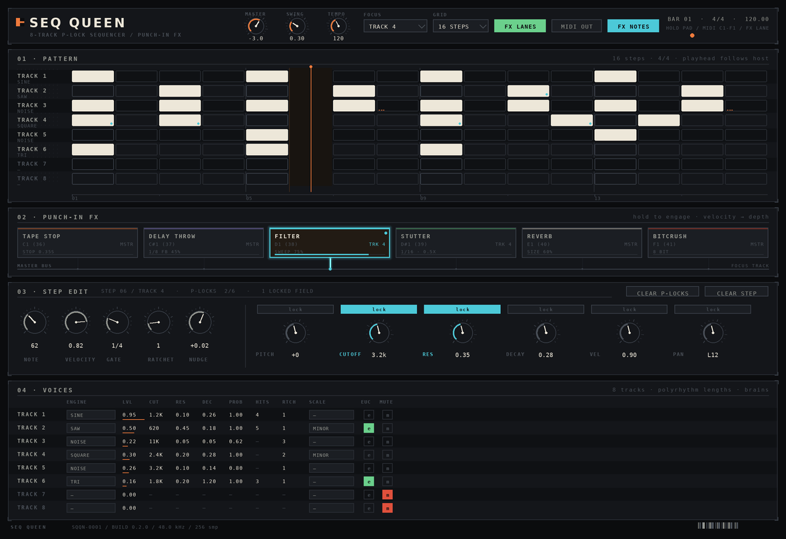

# Seq Queen

An OP-XY-inspired **instrument plugin** for not-quite-commercial, definitely-personal use:
an 8-track p-lock step sequencer with momentary **punch-in FX**.

Built with C++17 and JUCE 7. It is an *instrument*, not an audio effect: drop it on a
MIDI track in Ableton and it makes its own sound, the sequencer runs from the host
transport, and the punch-in FX are performed live (pads, MIDI notes, or automation).


> **Read this first if you are the next agent:** [`HANDOFF.md`](HANDOFF.md).
> The engine is finished and unit tested. The JUCE wrapper has never been through a
> compiler (no JUCE toolchain was available where it was written) — building it and
> fixing whatever surfaces is step one.

---

## What works today

| Area | State |
|---|---|
| 8 tracks, 1–64 steps each, polyrhythms | done |
| 16th-note clock, host-synced (PPQ) or free-running | done |
| Swing + per-step micro-timing (nudge) | done |
| Per-step **p-locks** (pitch, cutoff, resonance, decay, velocity, pan) | done |
| Brains: probability, Euclidean, ratchet, random pitch/velocity, scale quantise | done |
| Punch-in FX: tape stop, delay throw, filter sweep, stutter, reverb burst, bitcrush | done |
| **Sequenced punch FX**: one automation lane per FX, drawn in the sequencer | done |
| Velocity-sensitive punches (soft hit = gentler punch) | done |
| Per-FX routing: master bus or focused track | done |
| Momentary ramped engagement (click-free), tails that ring out after release | done |
| Synth engines per track: sine / triangle / saw / square / noise + noise layer | done |
| Play-along from MIDI, punch FX from MIDI notes, MIDI out from the sequencer | done |
| Host save/load (parameters + step grid) | done |
| Editor: step grid, punch pads, p-lock editor, per-track mixer | written; syntax-checked against JUCE headers, not yet built |
| Song mode / pattern chaining, piano roll, per-step sample playback | not started |

## The look

The whole UI is hand-drawn `paint()` code — no images, no resources. The design
spec lives beside it in `docs/ui/`:



`docs/ui/render_mockup.py` renders that PNG (and the FX-lanes view); the C++ in
`Source/Plugin/` is written against the same palette and geometry. Tokens are in
`Source/Plugin/Theme.h`, component styling in `SeqQueenLookAndFeel.*`. See
`docs/ui/README.md` for the layout map.

## Hear it before you build it

`demo/opxy_demo.wav` (34 s) is rendered by the real engine — `tools/render_demo.cpp`
plays a groove and punches in every effect:

```
bars 1–2   kick + hats
bars 3–4   + bass
bars 5–6   + lead (p-locked cutoff / resonance / pitch) + clap
bar 7      tape stop
bar 8      delay throw
bar 9      filter sweep
bar 10     stutter (three hits)
bar 11     reverb burst
bar 12     bitcrush
bar 13     stutter **sequenced** on every 16th (fired by the FX lane, not by hand)
bar 14     bitcrush **sequenced** on steps 3 and 7
bar 15     tape stop **sequenced** on the "and" of each beat
bars 13–16 brains: euclidean bass, probability hats, ratchet + minor-scale lead
```

Regenerate it any time with:

```bash
cmake --preset core && cmake --build --preset core
./build/core/opxy_demo demo/opxy_demo.wav
```

## Build (macOS)

Requirements: macOS 10.13+, Xcode command line tools, CMake 3.22+.
Ninja is optional (`brew install ninja`, then `cmake --preset mac-release -G Ninja`)
and just makes the build faster.

```bash
cmake --preset mac-release        # fetches JUCE 7.0.12 on first run (~1 min)
cmake --build --preset mac-release -j8
```

`COPY_PLUGIN_AFTER_BUILD` is on, so the binaries land in:

```
~/Library/Audio/Plug-Ins/VST3/Seq Queen.vst3
~/Library/Audio/Plug-Ins/Components/Seq Queen.component
build/mac-release/..._artefacts/Release/Standalone/Seq Queen.app
```

Already have a JUCE checkout? Skip the download:

```bash
cmake -S . -B build -G Ninja -DCMAKE_BUILD_TYPE=Release -DOPXY_JUCE_PATH=/path/to/JUCE
```

Build only the engine (no JUCE, works anywhere):

```bash
cmake --preset core && cmake --build --preset core
ctest --preset core          # or ./build/core/opxy_core_tests
```

## In Ableton (Live 11/12)

1. Rescan plug-ins (Preferences → Plug-Ins), or restart Live.
2. Drop **Seq Queen** from *Instruments* onto a MIDI track.
3. Press play in Live — the sequencer follows the host transport and tempo.
4. Hold the punch pads (or automate the `… Punch` parameters) for momentary FX.

**Punch-in FX from MIDI:** notes **C1–F1 (36–41)** punch FX 1–6 by default while held;
change the base note, or turn the mapping off, in the header. Each pad shows its note
(C1 = MIDI 36; the number is shown too because DAWs disagree about octave numbering).
Notes outside that range play the focused track's engine, so you can jam over the pattern.

**Velocity is part of the punch:** a soft MIDI note punches gently, a hard one punches
fully (`Velocity Amount` per FX, default 70%; pads count as full strength).

**Sequencing the punches:** hit `FX LANES` in the header and the grid swaps to six
automation lanes — one per FX. Draw where a punch should fire; each lane step carries
its own amount, so a lane can be a hard stutter rhythm or a half-strength wash.
Right-click a lane to clear it. This is the OP-XY gesture that makes the plugin what it
is, and it is why the sequencer and the FX live in the same plugin.

**MIDI out:** enable `MIDI OUT` in the header, then in Live set the track's
*MIDI To* to another track to drive it. Track 1–8 map to MIDI channels 1–8.

## Layout

```
Source/
  Core/            JUCE-free engine — the part with tests (start here)
    Types.h            constants, enums, step events
    Pattern.h/.cpp     tracks, steps, p-locks, brains, Euclidean
    Sequencer.h/.cpp   sample-accurate clock, swing, nudge, ratchet, pending queue
    SynthEngine.*      voice pool, oscillators, filter, envelopes
    PunchInFx.*        base class: momentary ramp + two mixing styles
    TapeStopFx.*  DelayThrowFx.*  FilterSweepFx.*
    StutterFx.*   ReverbBurstFx.*  BitcrushFx.*
    FxChain.*          the six effects in one bus
    Engine.*           rendering, FX routing, per-track buffers, master
    PatternState.*     step-grid serialisation for save/load
  Plugin/          JUCE wrapper (processor, editor, components)
tests/CoreTests.cpp    28 tests, no JUCE required
tools/render_demo.cpp  offline demo renderer
docs/                  architecture, p-lock semantics, how to add an FX
```

## Status / next steps

See [`HANDOFF.md`](HANDOFF.md) for the prioritised list. Short version:
compile the JUCE target, fix the fallout, then add pattern chaining, a per-step
pitch/velocity piano roll view, and sample playback per track.

## Licence

Personal learning project. JUCE is used under its GPLv3 option, so treat the
combined work as GPLv3-compatible; the DSP is written from scratch here (no code
copied from the GPL projects in the original brief — they are references only).
